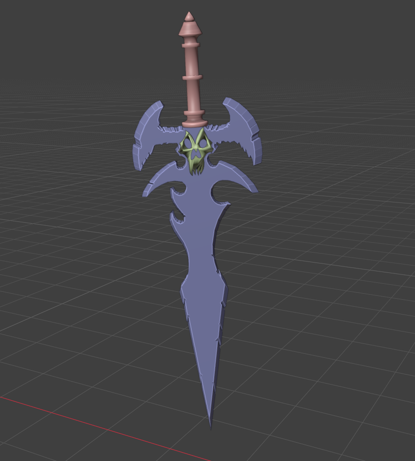
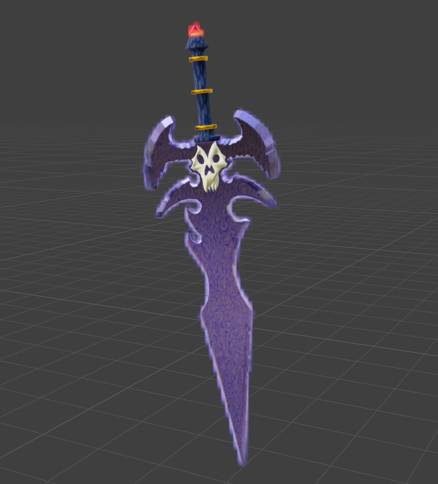
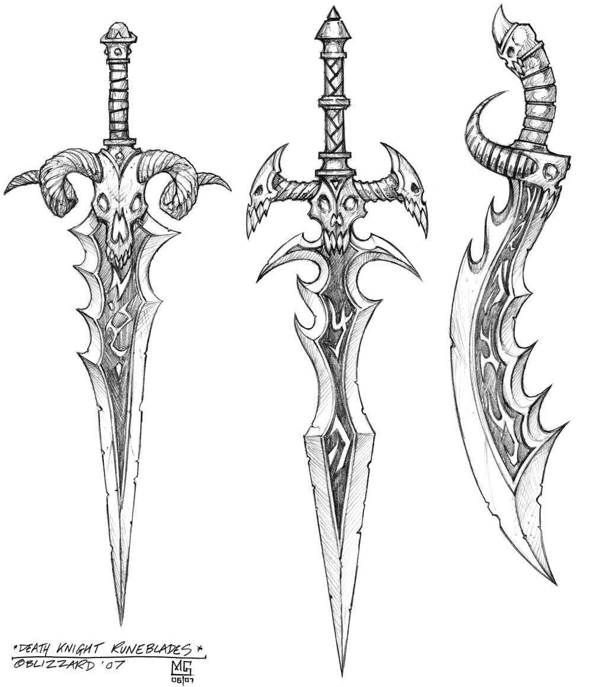

# ⚔️ Death Knight Runeblade — 3D Model

> A dark fantasy sword modeled in **Blender**, inspired by the *Death Knight Runeblades* concept art from Blizzard (2007).  
> Features a skull guard, wing-shaped crossguard, and a jagged demonic blade with hand-painted textures.

---

## 📋 Table of Contents

- [About](#-about)
- [Screenshots](#-screenshots)
- [Reference](#-reference)
- [Features](#-features)
- [Animation](#-animation)
- [Getting Started](#-getting-started)
- [Project Structure](#-project-structure)
- [Built With](#️-built-with)
- [Author](#-author)
- [License](#-license)

---

## 📖 About

This project is a **3D fan-art recreation** of the iconic Death Knight Runeblade weapon from the Blizzard universe.  
The model was built entirely from scratch in Blender using the official 2007 concept art as a reference,  
focusing on clean topology, stylized hand-painted materials, and a smooth animation showcase.

---

## 📸 Screenshots

| Solid View | Material View |
|:-----------:|:-------------:|
|  |  |

---

## 🎨 Reference

The model was based on the official **Death Knight Runeblades** concept art by Blizzard Entertainment (2007).



---

## ✨ Features

- 🗡️ Fully modeled demonic sword with skull, wings, and jagged blade
- 🎨 Hand-painted stylized textures with purple/dark tones
- 💎 Red gem detail on the pommel
- 🏗️ Clean mesh topology
- 🎬 Turntable animation render included

---

## 🎬 Animation

A turntable animation render is included in `images/Animation.mp4`.

---

## 🚀 Getting Started

### Prerequisites

- [Blender](https://www.blender.org/download/) **3.0 or higher**

### Open the Project

```bash
# Clone or download this repository
git clone https://github.com/your-username/sword-project.git

# Open the Blender file
blender "Sword Project/sword.blend"
```

Or simply open `sword.blend` directly from the **Blender File > Open** menu.

---

## 📁 Project Structure

```
Sword Project/
├── sword.blend          # Main Blender scene
├── images/
│   ├── Reference.jpg    # Concept art reference (Blizzard 2007)
│   ├── Solideview.png   # Solid viewport render
│   ├── matirealview.png # Material/texture render
│   └── Animation.mp4    # Turntable animation
└── README.md
```

---

## 🛠️ Built With

| Tool | Usage |
|------|-------|
|  | 3D Modeling, Texturing & Rendering |

---

## 👤 Author

**Melek**  
*3D Artist · Blender Enthusiast*

---

## 📜 License

This project is for **educational and portfolio purposes only**.  
The original concept art belongs to **Blizzard Entertainment** — all rights reserved to them.

---

*Created: July 2026*
